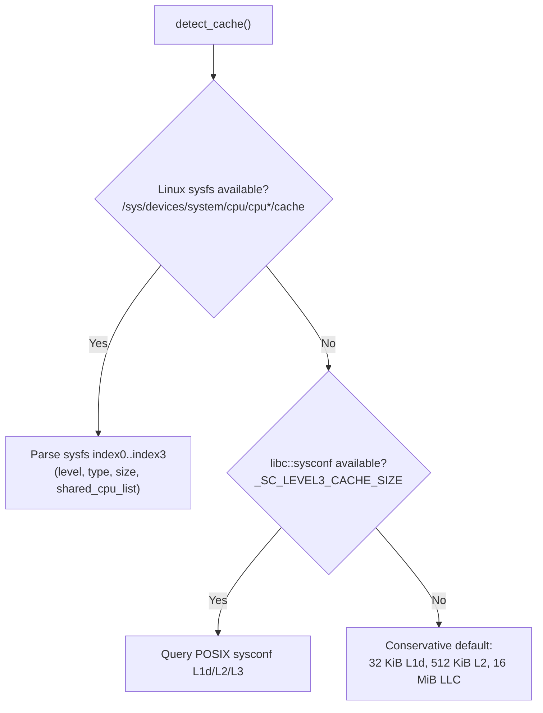

<!-- Copyright 2026 RealBrakedownPerf Authors. Licensed under Apache-2.0. -->

# Step 07: LLC-Aware Slicing, Runtime Cache Detection & Adaptive Auto-Tuning (`step/07-slicing`)

This document details the design, algorithmic formulation, microarchitectural analysis, and verification of **Last-Level Cache (LLC) slicing**, **portable runtime cache detection**, and **adaptive slice auto-tuning** (Plan 04 §2, README §8.1 M4) in `lcpc-brakedown-pc` and `lcpc-bench`.

---

## 1. Background & Motivation

In Brakedown-style polynomial commitment schemes, committing to a multilinear polynomial with $N = 2^\ell$ coefficients arranges the evaluations into a $k \times k$ matrix ($k = 2^{\lfloor \ell/2 \rfloor} = \sqrt{N}$), and encodes each row into an expander codeword of length $n \approx 1.72 k$.

In `step/03` through `step/06`, all $n_{\text{rows}}$ rows are encoded in one batched column-major pass with lazy modular accumulation and multi-edge blocking ($B = 4$). In this batched layout, each expander graph edge $(l, r, w)$ streams across all $n_{\text{rows}}$ elements of column $l$ with unit stride:

$$W_{\text{left}}(s=1) = n_{\text{per\_row}} \cdot n_{\text{rows}} \cdot 16\text{ bytes} = 16 N\text{ bytes}$$

### The LLC Thrashing Problem at $N \ge 2^{20}$

During right-to-left (R2L) evaluation of the top-level expander graph $G_1$:
- The graph has $L_1 = k$ left columns, $R_1 \approx 0.238 k$ right columns, and $E_1 = 10 k$ edges.
- Each left column is accessed pseudo-randomly an average of $c_n / \alpha \approx 10 / 0.238 \approx 42$ times across the evaluation of $R_1$ right columns.
- **When Left Nodes Fit in LLC:** If the left-node working set fits in the shared Last-Level Cache (LLC / L3), each left column is fetched from DRAM **at most once** on its first reference and hits in cache on all subsequent 41 references.
- **When Left Nodes Exceed LLC:** At $\log_2 N = 20$, $W_{\text{left}} = 16\text{ MiB}$; at $\log_2 N = 22$, $W_{\text{left}} = 64\text{ MiB}$; at $\log_2 N = 24$, $W_{\text{left}} = 256\text{ MiB}$. On CPUs with a 16 MiB or 32 MiB LLC, pseudo-random column loads evict previously fetched columns before they can be reused, causing frequent LLC misses and stalling on DRAM latency.

---

## 2. Horizontal Batch Slicing Architecture

To eliminate LLC thrashing while maintaining unit-stride streaming locality, `step/07-slicing` partitions the $n_{\text{rows}}$ rows of the coefficient matrix into $s \ge 1$ horizontal slices:

$$R_s = \lfloor n_{\text{rows}} / s \rfloor$$

Each slice $i \in [0, s)$ spans rows $[r_{\text{start}}(i), r_{\text{end}}(i))$:
- $r_{\text{start}}(i) = i \cdot R_s$
- $r_{\text{end}}(i) = (i + 1) \cdot R_s$ for $i < s - 1$, and $r_{\text{end}}(s - 1) = n_{\text{rows}}$ (cleanly absorbing any remainder rows $n_{\text{rows}} - (s - 1) R_s$).

### Single-Buffer Memory Footprint Optimization

Rather than allocating a full $n_{\text{cols}} \times n_{\text{rows}}$ matrix for column-major staging, the engine preallocates a single reusable slice buffer of size:

$$\text{buffer\_len} = n_{\text{cols}} \times R_{\max}, \qquad R_{\max} = \max_{i} (r_{\text{end}}(i) - r_{\text{start}}(i))$$

Across all $s$ slices, this single buffer is reused:
1. Transpose row-major input rows $r_{\text{start}}..r_{\text{end}}$ from `comm` into `slice_buf[..n_cols * h]` via cache-tiled `transpose_into`.
2. Fully evaluate the recursive expander code on the slice via `encode_col_major(slice_buf, h, &self.code)`.
3. Transpose column-major redundancy columns from `slice_buf[n_per_row * h..]` back into `comm[r_start * n_cols + n_per_row..]`.

When $s > 1$, this slashes scratch memory footprint by up to $s\times$, dramatically reducing peak Resident Set Size (RSS).

---

## 3. Portable Runtime Cache Detection (No `cpuid`)

Unlike upstream SIMD-Spielman which relied on compile-time `#define SELECTED_CPU` hard-coded tables, our implementation probes the host cache hierarchy dynamically at runtime in strict priority order (Plan 04 §2.2):

### Why No `cpuid`?
SIMD-Spielman's compile-time CPU tables and x86 `cpuid` intrinsics are non-portable. To strictly satisfy the project requirement of 100% portable scalar Rust across `x86_64`, `aarch64`, and `riscv64`, cache detection relies on OS-level queries (`sysfs` and `sysconf`), with zero architecture-specific instructions.

---

## 4. Closed-Form Analytical Slicing Model ($s^*$)

The recommended slice count $s^*$ is computed dynamically via `adaptive_slice_count`:

1. **Effective LLC Budget for Left Nodes ($\text{LLC}_{\text{budget}}$):**
   $$\text{LLC}_{\text{budget}} = \gamma \cdot \text{LLC}_{\text{shared}}, \qquad \gamma = 0.50$$
   The $\gamma = 0.50$ headroom accommodates active expander graph metadata ($\approx 200\text{ KiB}$), per-thread scratch accumulators, recent destination columns, and pseudo-random associativity conflicts.

2. **Minimum Power-of-Two Slices ($s_{\text{llc}}$):**
   $$s_{\text{llc}} = \text{next\_power\_of\_two}\left(\left\lceil \frac{16 N}{\text{LLC}_{\text{budget}}} \right\rceil\right)$$

3. **Minimum Rows-per-Slice Constraint ($R_{\min} = 16$):**
   To prevent unit-stride streaming degradation and excessive graph streaming overhead:
   $$s^* = \text{clamp}\left(s_{\text{llc}}, \; 1, \; \text{prev\_power\_of\_two}\left(\frac{n_{\text{rows}}}{R_{\min}}\right)\right)$$

### Validation against Plan 04 §2.2 Table 166

The implementation matches the planned model across all problem sizes and LLC sizes:

| $\log_2 N$ | $k = \sqrt{N}$ | $W_{\text{left}}(s=1)$ | $s^*$ for 16 MiB LLC (i7-11700K) | $s^*$ for 32 MiB LLC (GCP Zen 4) | Rows / Slice $R_s$ (16 MiB LLC) |
| :---: | :---: | :---: | :---: | :---: | :---: |
| **16** | 256 | 1 MiB | **1** | **1** | 256 |
| **18** | 512 | 4 MiB | **1** | **1** | 512 |
| **20** | 1,024 | 16 MiB | **2** | **1** | 512 |
| **22** | 2,048 | 64 MiB | **8** | **4** | 256 |
| **24** | 4,096 | 256 MiB | **32** | **16** | 128 |
| **26** | 8,192 | 1,024 MiB | **128** | **64** | 64 |
| **28** | 16,384 | 4,096 MiB | **512** | **256** | 32 |

---

## 5. Empirical Micro-Auto-Tuner (`autotune_slices`)

Because expander graph sampling is independent of the slice count $s$, the runtime provides an empirical auto-tuner:
- Invoked via `enc.autotune(n_rows)` or `lcpc-bench --autotune`.
- Sweeps candidate slice counts $s \in \{s^*/2, s^*, 2s^*, 4s^*\}$ (filtered to valid slice counts).
- Performs 1 warm-up and 2 timed iterations per candidate and locks in the empirically fastest $s$.
- `BenchReport` explicitly records `slices` and `slice_mode` (`"adaptive"`, `"explicit"`, or `"autotuned"`).

---

## 6. Verification and Invariants

1. **Slice Invariance:**
   For any message matrix, running the encoder with $s \in \{0\text{ (adaptive)}, 1, 2, 4, 8, 16\}$ yields **100% bit-exact identical codewords**:
   $$\hat{\mathbf{U}}^{(s=0)} == \hat{\mathbf{U}}^{(s=1)} == \hat{\mathbf{U}}^{(s=2)} == \hat{\mathbf{U}}^{(s=4)} == \hat{\mathbf{U}}^{(s=8)} == \hat{\mathbf{U}}^{(s=16)}$$
   Verified across `Mont127`, `Mers127`, `Fp2M61`, both parameter modes (a and b), square dimensions, and non-square dimensions testing remainder row boundaries.
2. **Oracle & Baseline Bit-Exactness:**
   All golden vector suites (`lcpc-orig`, `tv/` SIMD-Spielman test vectors) and algebraic linearity tests pass with zero regressions.
3. **Scalar Codegen Verification:**
   `scripts/check_codegen.py` confirms that hot kernels remain strictly scalar with 0 vector instruction violations.
